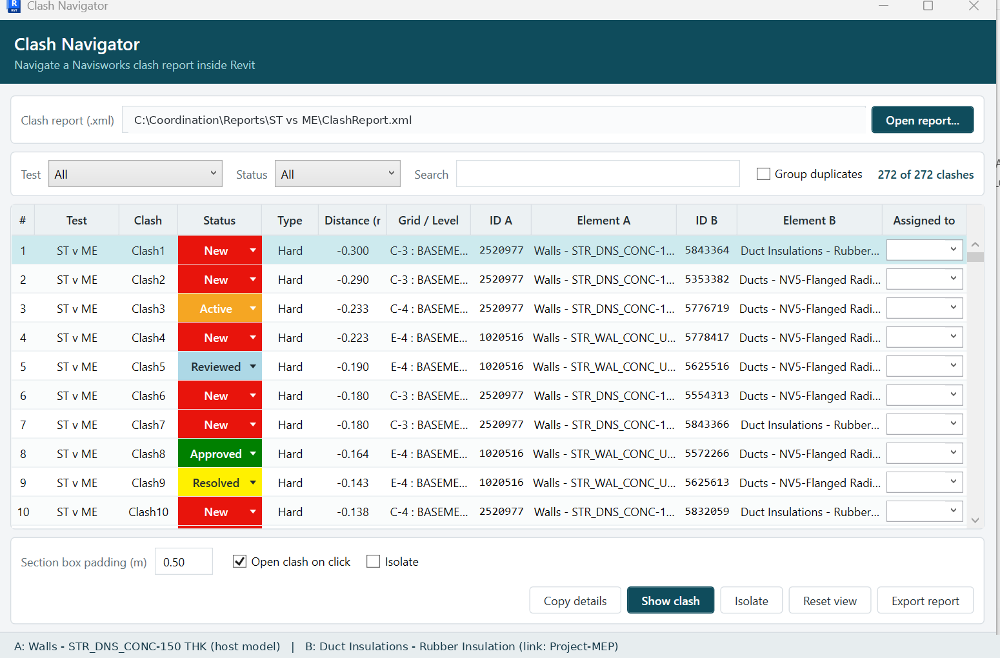
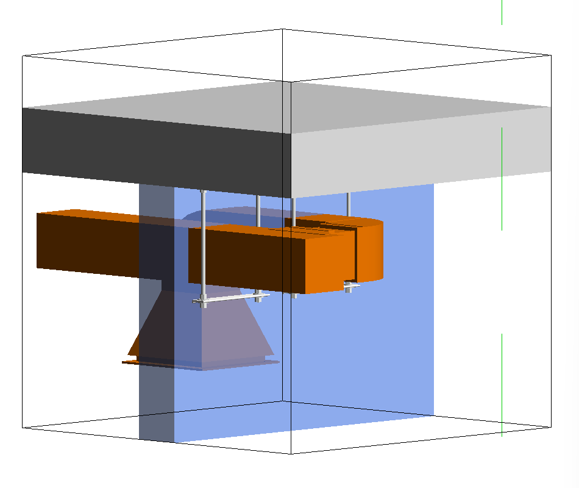

# ClashNavigator

**Review your Navisworks clashes inside Revit.**

[](#supported-versions)
[](LICENSE)
[](https://github.com/mohamedyasser4455/ClashNavigator/raw/main/dist/ClashNavigator-Setup.exe)

Navisworks finds the clashes. Revit is where you fix them. Nothing connects the two.

ClashNavigator reads the XML clash report exported from Navisworks Clash Detective, lists every clash inside Revit, and frames any clash you click — a 3D view with a tight section box around the actual overlap, both elements selected, whether they live in the host model or in a Revit link.



<p align="center">
  <br>
  <em>The section box lands on the overlap between the two elements, not on their full extents.</em>
</p>

---

## The problem it solves

Reviewing a clash report today means two programs open side by side: read the element id in Navisworks, type it into *Select by ID* in Revit, hide everything around it by hand, look, go back. Minutes per clash, hundreds of clashes, and no record of who reviewed what.

ClashNavigator turns that into one click, and keeps the review decisions.

## What it does

- **Reads the report** — the `.xml` exported from Clash Detective, listing every clash with its test, status, type, overlap depth, grid and level.
- **Finds the real element** — matches each clash object to the live Revit element by element id *and* source model, so the same id in the host model and in a link is never confused. Falls back to the clash point when the report is ambiguous, and to a geometric search when the report carries no ids at all.
- **Frames the clash** — a dedicated `Clash View` with a section box built from the **overlap** between the two elements, not their full extents. A duct through a thirty-metre wall opens a box around the penetration, not around half the floor.
- **Works across the federated model** — host model, any loaded Revit link, or a clash between two different links.
- **Tracks the review** — every clash carries a status and an assignee, colour-coded with the same colours Navisworks uses. Decisions are saved beside the report and restored next time it is opened.
- **Groups duplicates** — one duct crossing forty beams is forty clashes but one decision. Group them and apply a status and an owner to all of them at once.
- **Exports** — a full clash summary as plain text to the clipboard, or the whole reviewed list as CSV.

> ClashNavigator does **not** run clash detection. Navisworks already does that well. This add-in takes its result and does the part Navisworks cannot: work on the live Revit elements.

---

## Install

### Option 1 — the installer (recommended)

1. **[Download ClashNavigator-Setup.exe](https://github.com/mohamedyasser4455/ClashNavigator/raw/main/dist/ClashNavigator-Setup.exe)**
2. Run it. It detects which Revit versions are on your machine and registers the add-in only for those.
3. Restart Revit. You will find a **ClashNavigator** tab on the ribbon.

**Windows SmartScreen will warn you.** The installer is not code-signed (a signing certificate is a paid, yearly thing). When you see *"Windows protected your PC"*, click **More info** then **Run anyway**. If you would rather not run an unsigned installer, use option 2.

### Option 2 — manual install

1. **[Download ClashNavigator-Manual-Install.zip](https://github.com/mohamedyasser4455/ClashNavigator/raw/main/dist/ClashNavigator-Manual-Install.zip)**
2. Copy the files for your Revit version into:
   ```
   C:\ProgramData\Autodesk\Revit\Addins\<year>\
   ```
   so you end up with:
   ```
   ...\Addins\2024\ClashNavigator.addin
   ...\Addins\2024\ClashNavigator\ClashNavigator.dll
   ```
3. Restart Revit.

---

## How to use it

### 1. Export the report from Navisworks — this step matters

In **Clash Detective -> Report tab**:

| Setting | Value |
|---|---|
| Contents | tick **Item ID** (Element ID), plus Item Name, Item Type, Layer, Path |
| Include | untick **Image** — it makes the export very slow and the add-in does not use it |
| Output -> Format | **XML** |

Without the Element ID in the report, the add-in falls back to a geometric search, which is slower and less certain.

### 2. In Revit

1. Open the host model with its links loaded.
2. **ClashNavigator tab -> Clash Navigator**.
3. **Open report…** and pick the `.xml`. The whole report is checked against the open model automatically — Navisworks node names are replaced with the real Revit category and family type.
4. Click any clash. Adjust **Section box padding** to see more context, or tick **Isolate** to hide everything else.
5. Set a **Status** and an **Assigned to** as you go. They save themselves.
6. **Export report** writes the reviewed list to CSV.

---

## Supported versions

| Revit | Runtime |
|---|---|
| 2022, 2023, 2024 | .NET Framework 4.8 |
| 2025, 2026 | .NET 8 |

One source, five build configurations, one installer. Developed and tested on Revit 2024.

---

## Known limitations

Being upfront about these:

- **Revit cannot isolate a single element inside a link.** With *Isolate* on, a link element isolates the whole link, not just that element. This is an API limitation, not a bug.
- **Bounding boxes are coarse for round geometry.** A pipe's bounding box is a box, so the section box around a pipe clash is slightly generous.
- **The report must carry Element IDs** to match reliably — see the export settings above.
- **Grouping duplicates is by element type pair**, so it tells you *what* repeats, not *where*.
- Tested against reports exported from Navisworks 2027. Other versions write the XML slightly differently; the parser is deliberately tolerant, but if your report does not load, [open an issue](../../issues) and attach it.

---

## Roadmap

Ideas I want to add. If one of these would help you, say so in an issue and it moves up.

- Suggest a likely resolution from the two categories and the overlap (sleeve, reroute, beam opening)
- Place the opening or sleeve family at the clash point instead of only showing it
- Compare two exports of the same test: what was closed, what is new, what came back
- A formatted PDF / Excel report with a captured image per clash
- Read the `.nwd` directly where the Navisworks API is available
- A shared decisions file so a whole coordination team reviews together

---

## Feedback and contributions

This is actively maintained and I want it to get better.

- **Something broken?** [Open an issue](../../issues) — attach the clash report if you can, with any confidential names removed.
- **An idea?** Issues too. I read all of them.
- **Pull requests** are welcome.

---

## Built with

C# · WPF (MVVM) · Revit API · Inno Setup

Built while taking the **BIM Application Development (C# & API)** diploma at **KAITECH**, which is where I learned the C# and Revit API fundamentals behind it. I used AI as a reviewing partner and to help write the test harnesses; the problem, the design, and the testing on a real 272-clash coordination model are mine.

## Author

**Mohamed Yasser** — BIM Engineer (Structure)
[LinkedIn](https://www.linkedin.com/in/mohamed-y-khalil)

## License

[MIT](LICENSE) — use it, change it, ship it. A credit is appreciated, not required.
